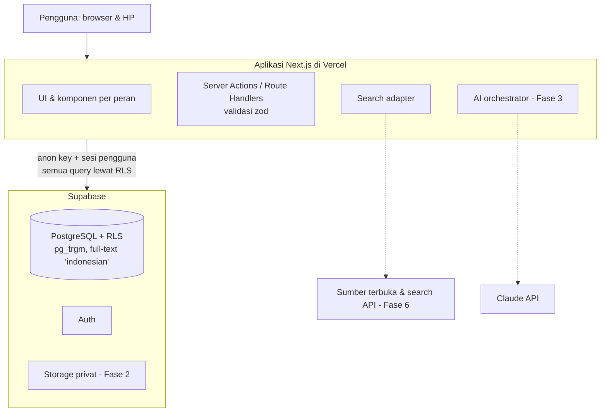
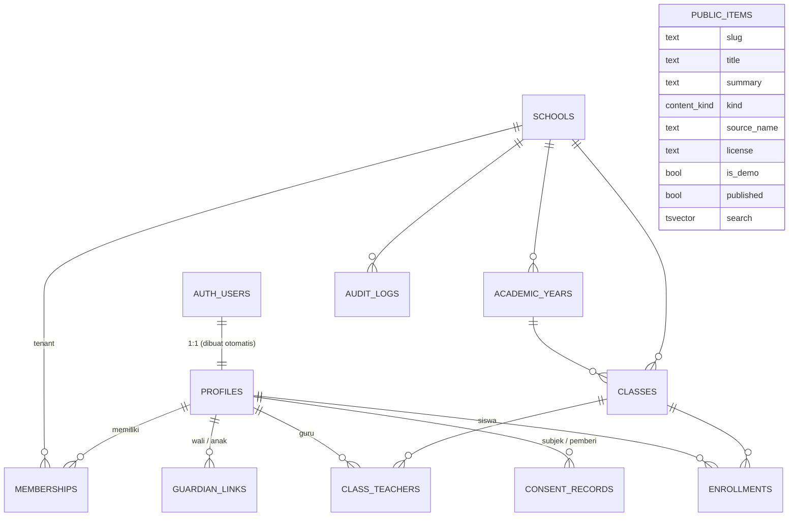

# Arsitektur

RUPA EDU adalah *modular monolith*: satu aplikasi Next.js (TypeScript) di atas Supabase (PostgreSQL + Auth + Storage). Batas modul dijaga lewat folder dan skema database, sehingga modul bisa dipisah kelak bila skala menuntut.

## Aturan keamanan inti

- Aplikasi web hanya memakai **anon key** + sesi pengguna. Setiap query tunduk pada Row-Level Security.
- **Service role key** tidak pernah dipakai oleh aplikasi web; hanya oleh skrip admin di luar web (mis. akun demo).
- Penulisan jejak audit hanya lewat fungsi `log_event()`; aktor diambil dari sesi, bukan dari klien.
- Fungsi pembantu policy berjalan `security definer` dengan `search_path` kosong untuk mencegah rekursi RLS dan pembajakan schema.

## Model data (Fase 1)

| Peran | Melihat |
| --- | --- |
| Pengunjung (anon) | Hanya `public_items` yang terbit |
| Siswa | Profil sendiri, guru kelasnya, kelas yang diikuti, baris pendaftarannya sendiri |
| Guru | Kelas yang diampu dan siswa di kelas itu |
| Wali | Anak yang terhubung, kelas dan pendaftarannya |
| Admin sekolah | Semua data sekolahnya, jejak audit sekolahnya; bisa mengelola tahun ajaran, kelas, pendaftaran |
| Super admin | Semua sekolah |

Semua aturan di atas diuji otomatis di `tests/db/rls.test.ts`.

Domain berikutnya (perpustakaan, penilaian, AI, kehadiran, karya, pengetahuan, marketplace) ditambahkan sebagai migration baru per fase; lihat dokumen Tahap 0.
